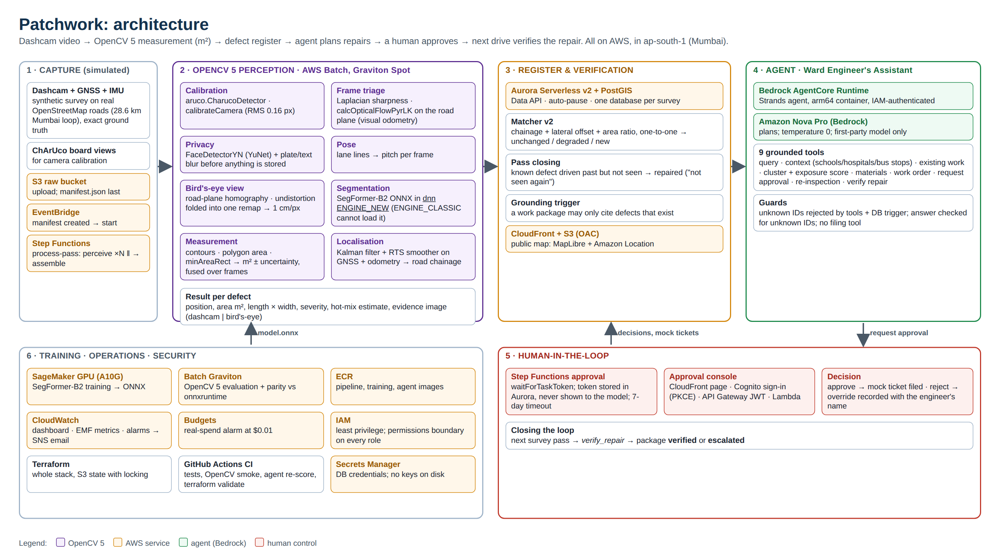

# Patchwork

**A measured road-defect register built from ordinary dashcam video, with OpenCV 5 on AWS.**

OpenCV AI Competition 2026 · Agentic Vision track · Team Googol · Author: **Ganeshan Arumuganainar**

Patchwork turns ordinary dashcam video into a map of road defects. For every pothole, broken road edge or sunken patch it records where it is, **how many square metres are damaged**, how serious it is, and how much asphalt the repair needs. When the same road is driven again, Patchwork checks each defect and marks it unchanged, worse, new, or actually repaired. An AI assistant on Amazon Nova then groups the defects into repair work packages, puts the ones near schools and hospitals first, and drafts work orders. **A human engineer approves each one before anything is filed.**

| Submission | Link |
|---|---|
| **Technical report** | [PDF](main_docs/submission/Patchwork-Technical-Report.pdf) · [Markdown](main_docs/submission/TECHNICAL-REPORT.md) |
| **Video (3 min 41 s)** | https://youtu.be/VupHYPRwLks (mirror: https://d3mt6jrs1ynczo.cloudfront.net/video/patchwork-demo.mp4) |
| **Live map** | https://d3mt6jrs1ynczo.cloudfront.net (synthetic survey data, labelled as such) |
| **Approval console** | https://d3mt6jrs1ynczo.cloudfront.net/console.html (sign-in; judge login supplied with the submission) |
| **Build, deploy, test** | [main_docs/submission/BUILD-DEPLOY-TEST.md](main_docs/submission/BUILD-DEPLOY-TEST.md) |
| **Everything for judges** | [main_docs/submission/](main_docs/submission/README.md) |



---

## How it works

```
dashcam video + GPS ──► S3 upload ──► EventBridge ──► Step Functions ──► AWS Batch (Graviton Spot, OpenCV 5 container)
                                                                          │
   frame triage → face/plate blur → calibration + undistortion → bird's-eye view (1 cm/px)
   → SegFormer-B2 segmentation in OpenCV 5 DNN ENGINE_NEW → area in m², severity, material
   → localisation (Kalman filter + map matching) → match against earlier passes (repaired = not seen again)
                                                                          │
                       Aurora Serverless v2 (PostgreSQL + PostGIS): the defect register
                                │                                      │
             CloudFront map viewer (MapLibre + Amazon Location)   Agent (Strands + Amazon Nova on Bedrock)
                                                                   query → existing work → cluster → estimate → draft work order
                                                                   → request approval (Step Functions task token)
                                                                   → human approves → mock ticket filed
                                                                   → next pass → verify_repair → verified / escalated

Training: SageMaker GPU (NVIDIA A10G) → ONNX → scored through OpenCV 5 on Graviton (AWS Batch)
```

| Stage | OpenCV 5 used for |
|---|---|
| Calibration | ChArUco board detection, `calibrateCamera` (RMS 0.16 px) |
| Bird's-eye view | Road-plane homography; undistortion folded into one `remap` |
| Triage | Laplacian sharpness, edge energy, Lucas–Kanade flow on the road plane (visual odometry) |
| Privacy | YuNet face detector (`FaceDetectorYN`) and a plate/text blur |
| Segmentation | SegFormer ONNX in the new DNN engine (`ENGINE_NEW`); the classic engine cannot load the model |
| Measurement | Contours and polygon area on the metric bird's-eye mask, fused over several frames |

## Results (final model `seg-v4` on the held-out survey: 28.6 km Mumbai loop, driven twice, 56.8 km)

| Metric | Result | Target |
|---|---|---|
| Potholes found (recall) | **0.99** (248/251) | ≥ 0.85 ✅ |
| Damaged-area error, full system (MAPE) | **13.9%** (median 7.9%) | ≤ 20% ✅ |
| Area error with true outlines (geometry only) | **2.1%**; without the bird's-eye view **46.9%** | ≤ 5% ✅ |
| False alarms on the clean control road | **0.25 per km** | ≤ 0.5 ✅ |
| Location error (median) | **2.6 m** | ≤ 8 m ✅ |
| Segmentation IoU, real photos (held-out test) | **0.72** | aim ≥ 0.55 ✅ |
| OpenCV 5 `ENGINE_NEW` vs onnxruntime | **3.2e-5** max difference, 100% same pixels | ≤ 1e-3 ✅ |
| Processing cost | **$0.0083 per km** | < $0.02 ✅ |
| Run A/B: the plan changes when only the measured area changes | priority **3 → 1**, hot-mix 0.03 → 0.40 t | must change ✅ |
| Repair verdicts on filed work orders, checked against truth | **8/8** correct | ✅ |
| Agent scenarios (live on Amazon Nova): answers citing an unknown ID | **0** | 0 (hard gate) ✅ |
| Same defect recognised on the next pass (F1) | 0.80 | ≥ 0.90 ❌ |
| **Real photos** (RDD2022-India, never trained on): pothole boxes found | **1%** (false alarms on 29% of clean photos) | reported ❌ |

Full table, midpoint → final comparison, the closed loop on AWS, cost and known limits: [`main_docs/FINAL-REPORT.md`](main_docs/FINAL-REPORT.md). Model: [`main_docs/MODEL-CARD.md`](main_docs/MODEL-CARD.md).

**The honest headline:** the measurement chain and the agent work end to end on AWS and are measured against exact truth, and the detector works on close-up pothole photos (IoU 0.72), but it does **not** yet transfer to real wide-angle Indian roadside photos (1% of potholes found). That needs pixel masks drawn on real Indian dashcam frames, which no open dataset has.

**Live:** map https://d3mt6jrs1ynczo.cloudfront.net · approval console https://d3mt6jrs1ynczo.cloudfront.net/console.html (sign-in required) · the agent also runs on Amazon Bedrock AgentCore Runtime (`scripts/aws/invoke_agent.py`).

**Released model:** `seg-clean-v1` (LR-ASPP MobileNetV3, trained on synthetic data only, licence-clean) in the [v1.0 release](https://github.com/intragalactic-stranger/OpenCV-Competition-Patchwork-Googol/releases/tag/v1.0); synthetic survey only, see [model card §9](main_docs/MODEL-CARD.md).

**About the data.** The survey drives are simulated on the real OpenStreetMap geometry of Mumbai's Coastal Road, Worli Sea Face, Haji Ali and Marine Drive, so every defect's true area, position and repair status is known exactly. The segmentation model also learns from real pothole photos (Pothole Mix). See [`main_docs/DATA-LICENSES.md`](main_docs/DATA-LICENSES.md).

## Quick start

Requirements: Python 3.12 via [uv](https://docs.astral.sh/uv/), Docker. AWS deployment additionally needs Terraform ≥ 1.10 and an AWS account.

```bash
make setup     # create .venv and install dependencies (OpenCV 5.0.0)
make check     # lint + unit tests
make smoke     # OpenCV 5 smoke test: DNN ENGINE_NEW, ChArUco, YuNet, ORB

uv run python scripts/setup_world.py   # survey loop from OpenStreetMap + ChArUco camera calibration

# render 2 km of synthetic survey with exact ground truth, then check the geometry with true masks
uv run python -m patchwork.synth --seed 7 --passes 1 --segment "Khan Abdul Gaffar Khan Marg" --max-m 2000
uv run python -m eval.metrics.area --oracle data/synth/seed07/pass_1

# full perception with a trained model (train one with training/train.py; see the model card)
uv run python -m patchwork.pipeline.runner perceive data/synth/seed07/pass_1/clip_0* --model path/to/model.onnx --out runs/local
uv run python -m patchwork.pipeline.runner assemble data/synth/seed07/pass_1 --model path/to/model.onnx --out runs/local --overlays
```

AWS: `infra/terraform/bootstrap` (state bucket and budget alarm), then `infra/terraform/envs/dev` (VPC, S3, ECR, Batch, Step Functions, Aurora, CloudFront). Every resource is tagged `Project=patchwork`; every IAM role carries the `patchwork-boundary` permissions boundary. Step-by-step: [`main_docs/plan/09-aws-infra-and-cost.md`](main_docs/plan/09-aws-infra-and-cost.md) and [`main_docs/midpoint/05-DEMO-GUIDE.md`](main_docs/midpoint/05-DEMO-GUIDE.md).

## Repository layout

```
src/patchwork/
  camera.py        camera model shared by the renderer and perception
  synth/           synthetic survey generator: OSM corridor, road renderer, defects, lifecycle, GNSS/IMU noise
  perception/      calib, triage, privacy, ipm, pose, segment, measure, localise
  pipeline/        Batch entry points (perceive / assemble), local runner, viewer publishing
  register/        Aurora Data API client, migrations, cross-pass matching
  schema/          the defect record: pydantic models + PostGIS DDL (tested to agree)
  agent/           Strands agent on Amazon Nova, grounded tools, system prompt
training/          dataset preparation, SegFormer training, ONNX export, parity check, model card
eval/              metrics, run A/B ablation, report generator
infra/terraform/   bootstrap + dev environment modules
docker/            arm64 Batch and training images
viewer/            static MapLibre map
main_docs/         ALL documentation: submission pack, final report, model card, licences, plan, midpoint
```

## Documentation

- [`main_docs/FINAL-REPORT.md`](main_docs/FINAL-REPORT.md): **the final report** (start here)
- [`main_docs/README.md`](main_docs/README.md): map of all documents
- [`main_docs/midpoint/09-REVIEWER-WALKTHROUGH.md`](main_docs/midpoint/09-REVIEWER-WALKTHROUGH.md): the story, in the order to show it
- [`main_docs/MODEL-CARD.md`](main_docs/MODEL-CARD.md): the segmentation model
- [`main_docs/midpoint/08-SERVICE-MAPPINGS.md`](main_docs/midpoint/08-SERVICE-MAPPINGS.md): every AWS service, what it does and what it cost
- [`main_docs/plan/`](main_docs/plan/): architecture, data strategy, schema, perception, agent design, evaluation plan, decision log

## Licence

Code: Apache-2.0 ([`LICENSE`](LICENSE)). The licence-clean model `seg-clean-v1` is released under Apache-2.0 (v1.0 release). The better SegFormer weights are **not** published: research-only because of their training data and pretrained encoder; see [`main_docs/DATA-LICENSES.md`](main_docs/DATA-LICENSES.md). Map data © OpenStreetMap contributors (ODbL).
