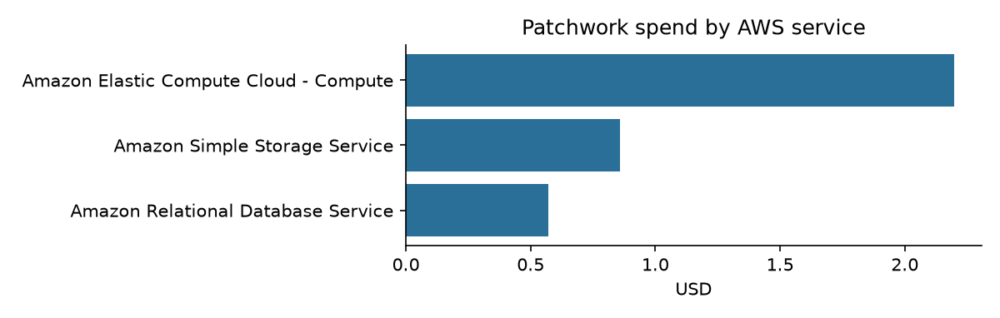

# Cost report

> **Generated** by `make cost-report` (`scripts/cost_report.py`) from **AWS Cost Explorer**. Do not edit the generated section by hand.
> Scope: all resources tagged `Project=patchwork` in account `682839842398`, region ap-south-1, plus the shared dev box listed separately.

## Summary

<!-- COST-SUMMARY:BEGIN -->
| Item | Value |
|---|---|
| Period | 2026-10-12 → 2026-10-14 (end exclusive) |
| Project usage (gross, before credits) | **$3.64** |
| Account usage since project start (gross) | $9.23 |
| Paid by AWS promotional credits | $9.23 |
| **Real money paid (net after credits)** | **$0.00** (guarded by the `patchwork-real-spend` budget: alert at $0.01) |
| Dev box (shared EC2 t3a.xlarge, us-east-1) | included above only if it is tagged |
| Planned monthly usage (from credits) | $300.00 |
| Account usage this month to date | $17.24 (5.7% of plan); net paid $0.00 |
| Kilometres processed (pipeline runs evaluated in `eval/results/end_to_end.json`) | 56.8 |
| Perception compute cost per km (measured run time × Spot price) | **$0.0021/km** (147 s of 4-vCPU Graviton Spot per km at $0.0128/vCPU-h, current Spot price) |
| Upper bound: all processing-service spend ÷ km (also includes data rendering and training) | $0.0638/km |
| Target cost per km (proposal) | < $0.02 |
| Generated | 2026-10-13 20:17 UTC by `make cost-report` |

Filtered by cost-allocation tag `Project=patchwork`.
<!-- COST-SUMMARY:END -->

## Credit coverage per service (must be ✅ for every row)

<!-- COST-CREDIT-COVERAGE:BEGIN -->
| AWS service | Usage | Paid by credits | Real money (net) | Covered? |
|---|---|---|---|---|
| Amazon Elastic Compute Cloud - Compute | $6.4253 | $6.4253 (incl. $0.0175 data-transfer credit) | $0.0000 | ✅ |
| Amazon Simple Storage Service | $0.8600 | $0.8600 (incl. $0.4285 data-transfer credit) | $0.0000 | ✅ |
| Amazon Relational Database Service | $0.5708 | $0.5708 | $0.0000 | ✅ |
| AWS Cost Explorer | $0.4200 | $0.4200 | $0.0000 | ✅ |
| EC2 - Other | $0.3957 | $0.3957 (incl. $0.0661 data-transfer credit) | $0.0000 | ✅ |
| Amazon Bedrock | $0.3252 | $0.3252 | $0.0000 | ✅ |
| Amazon Virtual Private Cloud | $0.2177 | $0.2177 | $0.0000 | ✅ |
| AWS Secrets Manager | $0.0049 | $0.0049 | $-0.0000 | ✅ |
| Amazon EC2 Container Registry (ECR) | $0.0031 | $0.0031 | $0.0000 | ✅ |
| Amazon Location Service | $0.0024 | $0.0024 | $0.0000 | ✅ |

**All services fully covered by promotional credits.**
<!-- COST-CREDIT-COVERAGE:END -->

## Spend by AWS service

<!-- COST-BY-SERVICE:BEGIN -->
| AWS service | What it is used for | Usage to date (gross, paid by credits) |
|---|---|---|
| Amazon Elastic Compute Cloud - Compute | Batch Graviton Spot instances (and dev box if untagged) | $2.20 |
| Amazon Simple Storage Service | Clips, crops, overlays, models, state | $0.86 |
| Amazon Relational Database Service | Aurora Serverless v2 PostGIS register | $0.57 |
| AWS Secrets Manager | Database credentials | $0.00 |
| Amazon EC2 Container Registry (ECR) |  | $0.00 |
| Amazon Location Service | Map tiles, snap-to-road | $0.00 |
<!-- COST-BY-SERVICE:END -->



## Spend by phase

<!-- COST-BY-PHASE:BEGIN -->
| Phase | Spend |
|---|---|
| (untagged) | $3.64 |
<!-- COST-BY-PHASE:END -->

## Who pays: AWS promotional credits (no real money)

Everything runs on **AWS promotional credits** (decision [D-27](../plan/11-decisions-and-risks.md)). The table above separates gross usage, the part paid by credits, and the **real money paid, which must stay $0.00**. A dedicated AWS Budget (`patchwork-real-spend`) measures cost *after* credits and e-mails the owner at the first cent. Services that credits usually exclude are not used: Marketplace, third-party Bedrock models, domain registration, Savings Plans, paid Support.

## Where the money goes and why (narrative, maintained by hand)

- **Training (SageMaker GPU, Spot)** is the largest one-off cost. Each experiment runs on `ml.g5.xlarge` Spot with a hard max runtime and checkpoints, and no GPU is left running.
- **Processing (Batch on Graviton Spot)** is the per-km cost. It is small because frame triage keeps only about 10% of frames and Spot is roughly 70% cheaper.
- **Database (Aurora Serverless v2)** auto-pauses when idle.
- **No NAT gateway** (it would cost more than all compute combined). See [decision D-05](../plan/11-decisions-and-risks.md).

## Pre-build estimate (for comparison)

| Line | Estimate for the first half |
|---|---|
| SageMaker training | $15–35 |
| Aurora Serverless v2 | $15–40 |
| Batch Graviton Spot | $3–10 |
| S3 + transfer | $3–8 |
| Bedrock + AgentCore (stretch) | $5–25 |
| Lambda, Step Functions, EventBridge, SQS, DynamoDB, API GW, CloudFront, Location | $3–12 |
| CloudWatch, KMS, Secrets Manager | $3–8 |
| **Total (excluding dev box)** | **≈ $50–140** |

## How to regenerate

```bash
make cost-report          # rewrites the generated sections above + assets/cost_by_service.png + assets/cost.csv
```
