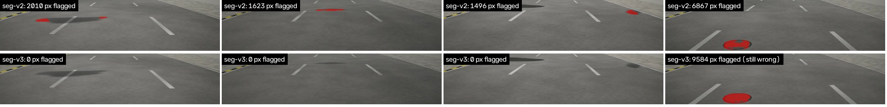

# Results and outputs

> Every number in this file is written by `make eval-midpoint` (`eval/report.py`), between the markers.
> Images are produced by the pipeline and saved to `assets/`. Nothing here is typed by hand except the commentary.

## 1. Headline metrics vs targets

<!-- METRICS:BEGIN -->
| Metric | Target | Result | Status |
|---|---|---|---|
| Detection recall (held-out world, D1) | ≥ 0.85 | 0.94 · 236/251 visible defects over 56.8 km; 3.12 FP/km overall | ✅ |
| False positives per km, Coastal Road control section (D2) | ≤ 0.5 | 0.30 · 6 FPs over 20.2 km | ✅ |
| Damaged-area MAPE, end to end (model masks) | ≤ 20% | 27.8% · n=229 measured defects; see assets/area_scatter.png | ❌ |
| Damaged-area MAPE, oracle masks (geometry only, estimated pitch) | ≤ 5% | 2.14% · n=18 defects; median 2.16%, p90 4.42%; true-pose 1.4%, nominal-pitch 4.44% | ✅ |
| Median localisation error | ≤ 8 m | 2.63 m · p90 6.51 m; raw GNSS median 6.23 m; tunnel (no GNSS) median 7.49 m; 37520 frames | ✅ |
| Segmentation IoU (damage), real photos (test split) | reported (aim ≥ 0.55) | 0.500 · segformer in OpenCV ENGINE_NEW; see 07-MODEL-CARD | ❌ |
| Segmentation IoU (damage), synthetic held-out stretch | reported (aim ≥ 0.75) | 0.569 · segformer in OpenCV ENGINE_NEW; see 07-MODEL-CARD | ❌ |
| ONNX parity: OpenCV 5 ENGINE_NEW vs onnxruntime (trained SegFormer-B0) | ≤ 1e-3 | 2.0e-05 · 50 images; 100.000% same pixel decisions; ENGINE_CLASSIC cannot load it | ✅ |
| Frame triage: kept frames per km (recall loss) | ≤ 620/km, ≤ 2% loss | 284/km, 0.0% loss · 21.63% of 15 fps frames; 98.9% of defects in ≥ 2 kept frames; odometry -0.6% over 28.558 km | ✅ |
| Processing time per km (Batch, Graviton, 4 vCPU per clip) | reported | 2.4 vCPU-container-min/km · clips run in parallel: wall-clock per pass ≈ time of the slowest clip | ℹ️ |
| Cost per km processed (perception compute, Graviton Spot) | < $0.02 | $0.0021 · 147 s × 4 vCPU per km at $0.01278/vCPU-h; upper bound incl. data rendering + training $0.0638/km; see 02-COST-REPORT | ✅ |
| Cross-pass re-ID F1, basic matcher (preview) | ≥ 0.90 (final, second half) | 0.73 · passes 1→2: precision 0.606, recall 0.905; repaired defects recognised as gone: 53% of 32 | ℹ️ |
| Run A/B: plan changes with measured area (agent on Amazon Nova) | must change | changed · 0.35 → 3.10 m²: priority 2 → 1, hot-mix 0.0456 → 0.4007 t; register source: pipeline output; see assets/ablation_ab.md | ✅ |

_Generated 2026-10-14 02:19 UTC by `uv run python -m eval.report`._
<!-- METRICS:END -->

## 2. Visual outputs

### 2.0 The survey corridor (real OpenStreetMap geometry)

*28.6 km loop: Marine Drive → Coastal Road (10.1 km control section, 3.1 km in tunnel) → Prabhadevi → Worli Seaface → Haji Ali → Warden Road → Kemps Corner → Marine Drive. 84 schools, hospitals and bus stops within 200 m feed the agent's prioritisation.*

### 2.1 The synthetic survey (real Mumbai corridor geometry)

*Left: rendered dashcam frame (1920×1080, lens distortion, bonnet, haze, sensor noise). Right: exact ground truth with each defect's true area. Shadows and wet patches are deliberate false-positive traps.*

### 2.2 Calibration with ChArUco (OpenCV 5 3D module)

### 2.3 Perspective → bird's-eye view, measured in m²

*Left: the recorded (distorted) frame with the defect outlined. Right: metric top-down view (1 cm/px, 1 m grid) built from the **estimated** calibration and the **per-frame pitch estimated from lane lines**. The lane markings come out parallel, which is a visual check that the geometry is right.*

### 2.4 Segmentation in OpenCV 5's new DNN engine

*Top: real road photos from the Pothole Mix test split. Bottom: synthetic dashcam strips from the held-out stretch. Green = ground truth, red = model (run in OpenCV 5 `ENGINE_NEW`). Each row shows the best cases and, last, the **worst** case on purpose.*

### 2.4b Where the false positives come from

*seg-v2, before the fine-tune: three pipeline detections on pass 1 that match no real defect: soft cast shadows next to lane markings. This is the largest error class (see §3).*

### 2.4c What the hard-negative fine-tune changed (seg-v2 → seg-v3)

*The same held-out look-alike frames (no damage in any of them) through seg-v2 (top) and seg-v3 (bottom). Red = pixels called damage, so every red pixel is a false alarm. Cast shadows that seg-v2 flagged are now clean. The last column is shown on purpose: a manhole cover that both models still flag. Across all 480 look-alike frames: 86 flagged → 41 (`07-MODEL-CARD` §7).*

### 2.5 Measured vs true area

### 2.6 The AWS pipeline running

### 2.7 The register on a map

Live viewer: https://d3mt6jrs1ynczo.cloudfront.net (synthetic survey over real Mumbai roads; clearly labelled as such on the page)

### 2.8 Agent preview: run A vs run B (stretch)
See [`assets/ablation_ab.md`](assets/ablation_ab.md): same clip and prompt, different measured area → different plan.

## 3. Commentary (honest reading of the numbers)

**What was run.** The held-out synthetic world (seed 11, never used for training) was uploaded as two survey passes over the 28.4 km loop (56.8 km in total). Each upload started the cloud pipeline on its own: S3 → EventBridge → Step Functions → Batch Graviton Spot (10 clips in parallel) → Aurora register → map viewer. Pass 1 took 17 min and pass 2 took 15 min wall-clock. The model is **`seg-v3`**: `seg-v2` fine-tuned with "look-alike" frames (shadows, wet patches, manholes, seams, old repairs) as examples of *not damage*, CPU only (see the [model card](07-MODEL-CARD.md)). The same survey was first run on `seg-v2`; both results are kept, so the table below is a like-for-like before/after.

| Same survey, same pipeline | seg-v2 | **seg-v3** | Target |
|---|---|---|---|
| Recall (visible defects found) | 0.95 (238/251) | **0.94** (236/251) | ≥ 0.85 |
| False positives per km, whole survey | 10.05 | **3.1** | – |
| False positives per km, Coastal Road control section | 3.87 | **0.30** | ≤ 0.5 |
| Area MAPE end to end | 33.7% | **27.8%** | ≤ 20% |
| Area MAPE, large depressions (≥ 1.5 m²) | 64% | **42%** | – |
| Re-ID F1 across passes | 0.57 | **0.73** | ≥ 0.90 (second half) |
| Repaired defects recognised as gone | 34% | **53%** | – |

Files: `eval/results/end_to_end_seg_v2.json`, `reid_seg_v2.json` (before) and `end_to_end.json`, `reid.json` (after).

**What works.**
- **Finding defects: recall 0.94.** 236 of the 251 visible defects were found over both passes. Potholes are found 95–99% of the time and depressions 94–96%.
- **False alarms down by two thirds, and the control-section target is met.** On the Coastal Road control section (clean surface, 20.2 km over both passes) there are 6 false alarms: **0.30 per km against a target of 0.5**. Over the whole survey it is 3.1 per km, down from 10.
- **Geometry.** Oracle-mask area error is 2.1%, so the bird's-eye view and calibration are not the bottleneck. Localisation has a median error of 2.6 m (pass 2: 3.7 m), better than raw GNSS at 6.2 m, and it works in the 3.1 km tunnel.
- **Measurement on small and medium potholes.** In the area scatter, potholes under about 0.6 m² sit close to the diagonal (median error 18%).
- **OpenCV 5.** The trained model runs in `ENGINE_NEW` with outputs identical to onnxruntime (2.0e-5). The classic engine cannot load it at all.
- **Cost.** Perception costs **$0.0021 per km** in measured compute on Graviton Spot, against a target below $0.02. Everything so far was paid by promotional credits; real money paid is $0.00.
- **Agent.** The run A/B test uses **real `seg-v3` pipeline output**: a pothole on Marine Drive the pipeline measured at 0.35 m² (true area 0.35 m², seen on both passes). Changing only its measured area to 3.10 m² moves the plan from priority 2 to priority 1 and the hot-mix from 0.05 t to 0.40 t. A road-wide run ("Plan repairs for Khan Abdul Gaffar Khan Marg") drafted **24 work packages** in 78 s (84 k Nova Pro tokens, about $0.10); on the `seg-v2` survey it drafted 31, the difference being mostly false alarms that are gone. The human gate works on pipeline output: the top package (3.40 m²) was approved and `filed` with a MOCK ticket, and a 0.02 m² package was `rejected` and recorded as an override.
- **Honest note on the agent's prose:** its final text summary listed one package twice and left one out. The packages, priorities, quantities and approval requests in the database were all correct. Those come from code over the register, not from the model's text, which is why the design never trusts the prose for numbers. A check of the summary against the register is on the second-half list (40-scenario evaluation).

**What does not work yet, and why.**
1. **False positives: 3.1 per km over the whole survey.** We checked every pass-1 false alarm against the synthetic world, for both models:

   | Cause (pass 1) | seg-v2 | seg-v3 |
   |---|---|---|
   | Cast shadows | 125 | 21 |
   | Wet patches | 64 | 17 |
   | Manhole covers | 24 | 21 |
   | Second blob beside a real defect (counted twice) | 58 | 34 |
   | Plain road | 24 | 2 |

   A false alarm that touches two kinds of look-alike (e.g. a shadow over a manhole) is counted in both rows. Total pass-1 false alarms: 289 → 87.

   Shadows and wet patches, the traps planted on purpose, are mostly fixed. **Manhole covers did not improve.** They are round, dark and textured, like a pothole, and the look-alike set has few of them. The largest remaining group is a **second blob next to a real defect**: one pothole split into two masks. That is a register de-duplication problem, not a vision one.
2. **Area error end to end: 27.8% MAPE, against a target of 20%.** The median error is 21%. Large shallow depressions (≥ 1.5 m²) improved from 64% to 42% error, but the model still marks only part of their soft edge, so they are under-measured. The geometry is not the cause, because oracle masks give 2.1%.
3. **Edge breaks at the kerb lost some recall** (8 of 15 found over both passes, against 11 with seg-v2). There are very few of them, but the direction is real: a broken kerb edge looks like a shadow at the kerb, and the fine-tune taught the model to ignore shadows there.
4. **Segmentation IoU** is 0.50 on real photos and 0.57 on synthetic frames, below the aims of 0.55 and 0.75. Both models are small (SegFormer-B0) and CPU-trained.
5. **Cross-pass re-identification (basic GNSS/chainage matcher): F1 0.73.** It finds 91% of the true links, and 61% of the links it makes are correct (42% with seg-v2). Repaired defects are recognised as gone 53% of the time; 16 false alarms still land on fresh repair patches in pass 2. Phase 6 adds the ORB/homography matcher.

**What the second half does about it (in order).**
- **Manholes and double blobs:** add manhole covers to the look-alike set, and merge masks of the same defect within a frame and across frames before they enter the register.
- **Depressions and accuracy in general:** SegFormer-B2 on GPU at higher resolution, soft-boundary labels for depressions, mask fusion across a defect's frames (`08-SERVICE-MAPPINGS` §5).
- **A temporal and shape check before a detection enters the register.** Shadows move with the sun and between passes; damage stays put.
- Every number above is regenerated by one command (`make eval-midpoint`), so each change is measured like for like.
