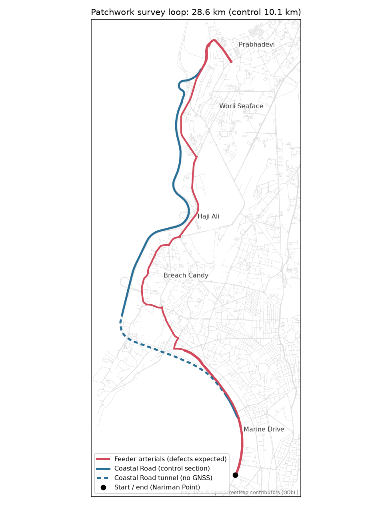
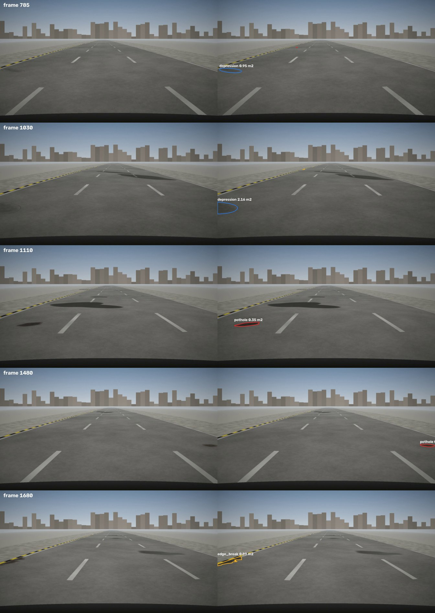
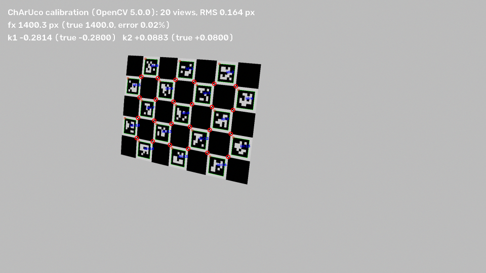
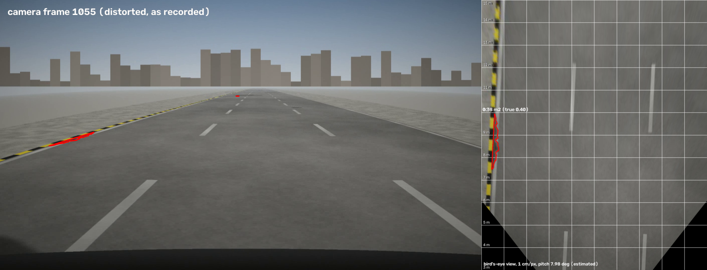
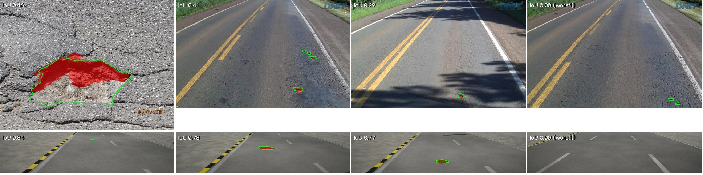
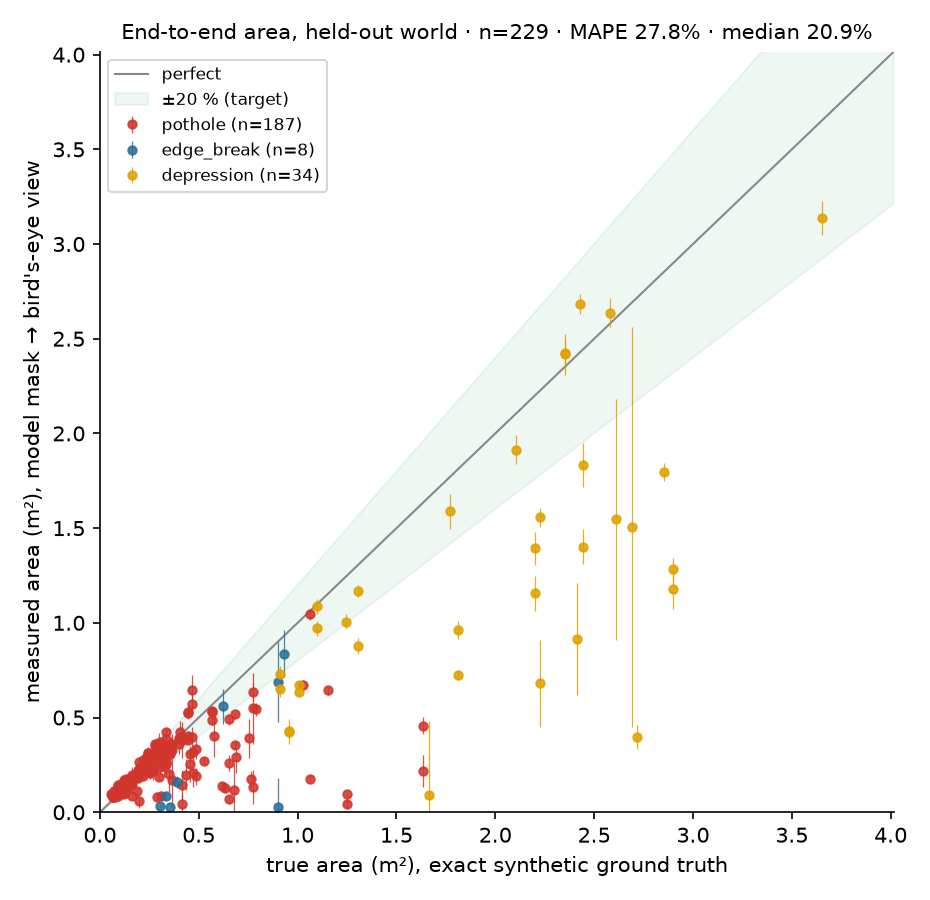
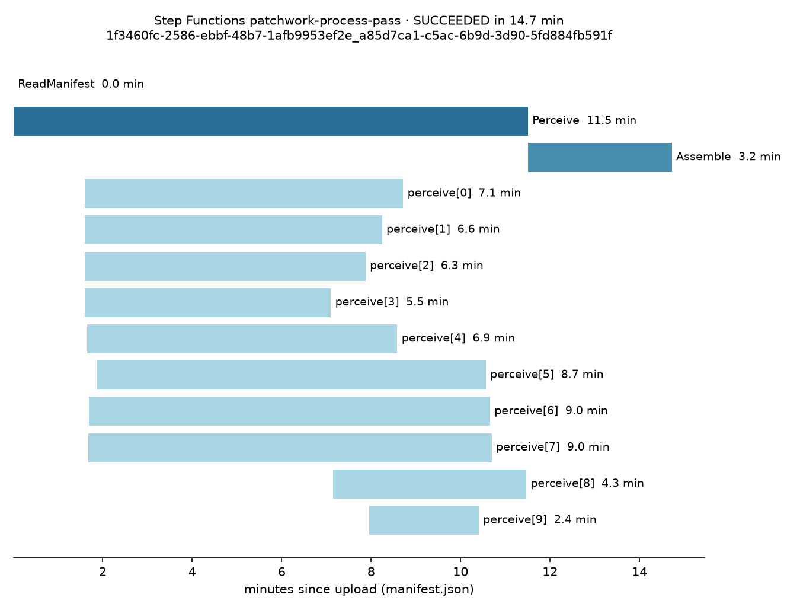
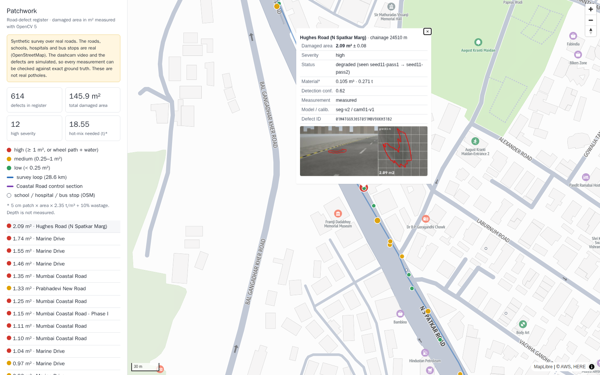

# Results and outputs

> Every number in this file is written by `make eval-midpoint` (`eval/report.py`), between the markers.
> Images are produced by the pipeline and saved to `assets/`. Nothing here is typed by hand except the commentary.

## 1. Headline metrics vs targets

<!-- METRICS:BEGIN -->
| Metric | Target | Result | Status |
|---|---|---|---|
| Detection recall @ ≤ 1 FP/km (D1) | ≥ 0.85 | [[TBD]] | ⏭ |
| False positives per km, control section (D2) | ≤ 0.5 | [[TBD]] | ⏭ |
| Damaged-area MAPE, end to end (D1) | ≤ 20% | [[TBD]] | ⏭ |
| Damaged-area MAPE, oracle masks (geometry only, estimated pitch) | ≤ 5% | 2.14% · n=18 defects; median 2.16%, p90 4.42%; true-pose 1.4%, nominal-pitch 4.44% | ✅ |
| Median localisation error | ≤ 8 m | [[TBD]] | ⏭ |
| Segmentation IoU (damage), real photos (test split) | reported (aim ≥ 0.55) | [[TBD]] | ⏭ |
| Segmentation IoU (damage), synthetic held-out stretch | reported (aim ≥ 0.75) | [[TBD]] | ⏭ |
| ONNX parity: OpenCV 5 ENGINE_NEW vs onnxruntime (SegFormer-like smoke graph) | ≤ 1e-3 | 3.8e-06 · ENGINE_CLASSIC cannot load it | ✅ |
| Frame triage: kept frames per km (recall loss) | ≤ 620/km, ≤ 2% loss | 297/km, 0.0% loss · 18.64% of 15 fps frames; 100.0% of defects in ≥ 2 kept frames; odometry -1.52% over 2.0 km | ✅ |
| Processing time per km (Batch, Graviton) | reported | [[TBD]] | ⏭ |
| Cost per km processed | < $0.02 | [[TBD]] | ⏭ |
| Cross-pass re-ID F1, basic matcher (stretch) | ≥ 0.90 (final) | [[TBD]] | ⏭ |
| Run A/B: plan changes with measured area (stretch) | must change | [[TBD]] | ⏭ |

_Generated 2026-10-13 04:51 UTC by `uv run python -m eval.report`._
<!-- METRICS:END -->

## 2. Visual outputs

### 2.0 The survey corridor (real OpenStreetMap geometry)

*28.6 km loop: Marine Drive → Coastal Road (10.1 km control section, 3.1 km in tunnel) → Prabhadevi → Worli Seaface → Haji Ali → Warden Road → Kemps Corner → Marine Drive. 84 schools, hospitals and bus stops within 200 m feed the agent's prioritisation.*

### 2.1 The synthetic survey (real Mumbai corridor geometry)

*Left: rendered dashcam frame (1920×1080, lens distortion, bonnet, haze, sensor noise). Right: exact ground truth with each defect's true area. Shadows and wet patches are deliberate false-positive traps.*

### 2.2 Calibration with ChArUco (OpenCV 5 3D module)

### 2.3 Perspective → bird's-eye view, measured in m²

*Left: the recorded (distorted) frame with the defect outlined. Right: metric top-down view (1 cm/px, 1 m grid) built from the **estimated** calibration and the **per-frame pitch estimated from lane lines**. The lane markings come out parallel, which is a visual check that the geometry is right.*

### 2.4 Segmentation in OpenCV 5's new DNN engine

*Top: real Indian road photos. Bottom: synthetic frames. Failure cases are included on purpose.*

### 2.5 Measured vs true area

### 2.6 The AWS pipeline running

### 2.7 The register on a map

Live viewer: [[TBD: CloudFront URL]]

### 2.8 Agent preview: run A vs run B (stretch)
See [`assets/ablation_ab.md`](assets/ablation_ab.md): same clip and prompt, different measured area → different plan.

## 3. Commentary (honest reading of the numbers)

[[TBD: written after the results exist. What works, what doesn't, why, and what the second half does about it.]]
