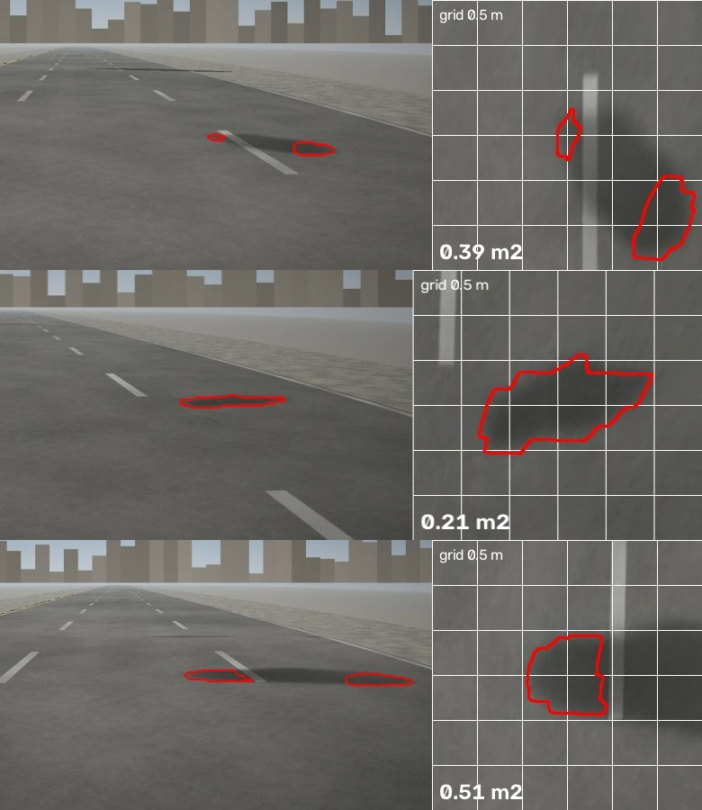

# Results and outputs

> Every number in this file is written by `make eval-midpoint` (`eval/report.py`), between the markers.
> Images are produced by the pipeline and saved to `assets/`. Nothing here is typed by hand except the commentary.

## 1. Headline metrics vs targets

<!-- METRICS:BEGIN -->
| Metric | Target | Result | Status |
|---|---|---|---|
| Detection recall (held-out world, D1) | ≥ 0.85 | 0.95 · 238/251 visible defects over 56.8 km; 10.05 FP/km overall | ✅ |
| False positives per km, Coastal Road control section (D2) | ≤ 0.5 | 3.87 · 78 FPs over 20.2 km | ❌ |
| Damaged-area MAPE, end to end (model masks) | ≤ 20% | 33.7% · n=236 measured defects; see assets/area_scatter.png | ❌ |
| Damaged-area MAPE, oracle masks (geometry only, estimated pitch) | ≤ 5% | 2.14% · n=18 defects; median 2.16%, p90 4.42%; true-pose 1.4%, nominal-pitch 4.44% | ✅ |
| Median localisation error | ≤ 8 m | 2.63 m · p90 6.51 m; raw GNSS median 6.23 m; tunnel (no GNSS) median 7.49 m; 37520 frames | ✅ |
| Segmentation IoU (damage), real photos (test split) | reported (aim ≥ 0.55) | 0.496 · segformer in OpenCV ENGINE_NEW; see 07-MODEL-CARD | ❌ |
| Segmentation IoU (damage), synthetic held-out stretch | reported (aim ≥ 0.75) | 0.428 · segformer in OpenCV ENGINE_NEW; see 07-MODEL-CARD | ❌ |
| ONNX parity: OpenCV 5 ENGINE_NEW vs onnxruntime (trained SegFormer-B0) | ≤ 1e-3 | 2.4e-05 · 50 images; 100.000% same pixel decisions; ENGINE_CLASSIC cannot load it | ✅ |
| Frame triage: kept frames per km (recall loss) | ≤ 620/km, ≤ 2% loss | 284/km, 0.0% loss · 21.63% of 15 fps frames; 98.9% of defects in ≥ 2 kept frames; odometry -0.6% over 28.558 km | ✅ |
| Processing time per km (Batch, Graviton, 4 vCPU per clip) | reported | 2.2 vCPU-container-min/km · clips run in parallel: wall-clock per pass ≈ time of the slowest clip | ℹ️ |
| Cost per km processed (perception compute, Graviton Spot) | < $0.02 | $0.0019 · 133 s × 4 vCPU per km at $0.01274/vCPU-h; upper bound incl. data rendering + training $0.0344/km; see 02-COST-REPORT | ✅ |
| Cross-pass re-ID F1, basic matcher (preview) | ≥ 0.90 (final, second half) | 0.57 · passes 1→2: precision 0.42, recall 0.908; repaired defects recognised as gone: 34% of 32 | ℹ️ |
| Run A/B: plan changes with measured area (agent on Amazon Nova) | must change | changed · 0.38 → 3.10 m²: priority 2 → 1, hot-mix 0.049 → 0.4007 t; register source: pipeline output; see assets/ablation_ab.md | ✅ |

_Generated 2026-10-13 11:56 UTC by `uv run python -m eval.report`._
<!-- METRICS:END -->

## 2. Visual outputs

### 2.0 The survey corridor (real OpenStreetMap geometry)

*28.6 km loop: Marine Drive → Coastal Road (10.1 km control section, 3.1 km in tunnel) → Prabhadevi → Worli Seaface → Haji Ali → Warden Road → Kemps Corner → Marine Drive. 84 schools, hospitals and bus stops within 200 m feed the agent's prioritisation.*

### 2.1 The synthetic survey (real Mumbai corridor geometry)

*Left: rendered dashcam frame (1920×1080, lens distortion, bonnet, haze, sensor noise). Right: exact ground truth with each defect's true area. Shadows and wet patches are deliberate false-positive traps.*

### 2.2 Calibration with ChArUco (OpenCV 5 3D module)

### 2.3 Perspective → bird's-eye view, measured in m²

*Left: the recorded (distorted) frame with the defect outlined. Right: metric top-down view (1 cm/px, 1 m grid) built from the **estimated** calibration and the **per-frame pitch estimated from lane lines**. The lane markings come out parallel, which is a visual check that the geometry is right.*

### 2.4 Segmentation in OpenCV 5's new DNN engine

*Top: real road photos from the Pothole Mix test split. Bottom: synthetic dashcam strips from the held-out stretch. Green = ground truth, red = model (run in OpenCV 5 `ENGINE_NEW`). Each row shows the best cases and, last, the **worst** case on purpose.*

### 2.4b Where the false positives come from

*Three pipeline detections on pass 1 that match no real defect: soft cast shadows next to lane markings. This is the largest error class (see §3).*

### 2.5 Measured vs true area

### 2.6 The AWS pipeline running

### 2.7 The register on a map

Live viewer: https://d3mt6jrs1ynczo.cloudfront.net (synthetic survey over real Mumbai roads; clearly labelled as such on the page)

### 2.8 Agent preview: run A vs run B (stretch)
See [`assets/ablation_ab.md`](assets/ablation_ab.md): same clip and prompt, different measured area → different plan.

## 3. Commentary (honest reading of the numbers)

**What was run.** The held-out synthetic world (seed 11, never used for training) was uploaded as two survey passes over the 28.4 km loop (56.8 km in total). Each upload started the cloud pipeline on its own: S3 → EventBridge → Step Functions → Batch Graviton Spot (10 clips in parallel) → Aurora register → map viewer. Pass 1 took 19 min and pass 2 took 17 min wall-clock. The model is `seg-v2`, trained on CPU only (see the [model card](07-MODEL-CARD.md)).

**What works.**
- **Finding defects: recall 0.95 on both passes.** 238 of the 251 visible defects were found. Potholes and depressions are both about 0.96; edge breaks at the kerb are 0.75.
- **Geometry.** Oracle-mask area error is 2.1%, so the bird's-eye view and calibration are not the bottleneck. Localisation has a median error of 2.6 m (pass 2: 3.9 m), better than raw GNSS at 6.2 m, and it works in the 3.1 km tunnel.
- **Measurement on small and medium potholes.** In the area scatter, potholes under about 0.6 m² sit close to the diagonal.
- **OpenCV 5.** The trained model runs in `ENGINE_NEW` with outputs identical to onnxruntime (2.4e-5). The classic engine cannot load it at all.
- **Cost.** Perception costs **$0.0019 per km** in measured compute on Graviton Spot, against a target below $0.02. Everything so far was paid by promotional credits; real money paid is $0.00.
- **Agent.** The run A/B test now uses **real pipeline output**: a pothole the pipeline measured at 0.38 m² (true area 0.40 m², seen on both passes). Changing only its measured area to 3.10 m² moves the plan from priority 2 to priority 1 and the hot-mix from 0.05 t to 0.40 t. The human gate also works on pipeline output: an approved package is `filed` with a MOCK ticket, and a rejected one is `rejected` and recorded as an override.

**What does not work yet, and why.**
1. **False positives: 10 per km, against a target of 0.5.** In pass 1 we checked every false alarm against the synthetic world. About 60% of them fall on deliberate traps: cast **shadows** (about 120) and **wet patches** (about 60). Manholes, seams and speed breakers add about 25 more. Most of the rest are dark blobs a few metres beside real defects; about 24 are on plain road. The model learned "damage" mostly from real photos (Pothole Mix), which contain few hard cast shadows, so a soft dark blob on asphalt looks like damage to it. This is the D4 "false-positive zoo" doing its job.
2. **Area error end to end: 34% MAPE, against a target of 20%.** The median error is 25%. The error is concentrated in **large shallow depressions** (1.5–3.7 m²): the model marks only their darkest core, so it under-measures them by half or more. Small potholes are measured well. The geometry is not the cause, because oracle masks give 2.1%.
3. **Segmentation IoU** is 0.50 on real photos and 0.43 on synthetic frames, below the aims of 0.55 and 0.75. This is one 12-epoch CPU run; the training curve was still rising.
4. **Cross-pass re-identification (basic GNSS/chainage matcher): F1 0.57.** It finds 91% of the true links, but only 42% of the links it makes are correct, because false-positive blobs link to other false-positive blobs. Repaired defects are recognised as gone only 34% of the time: in pass 2, 22 false alarms land on fresh repair patches. Both problems shrink once false positives drop, and Phase 6 adds the ORB/homography matcher.

**What the second half does about it (in order).**
- **Hard-negative fine-tune:** add shadows, wet patches, manholes and repair patches from the *training* world (seed 07) as "not damage", then fine-tune `seg-v2`. Estimated 1.5 h of CPU and about $1 of credits. This targets item 1 directly and helps item 4.
- **Depressions:** label them with a soft boundary, train at a larger input size, and fuse each defect's mask across its frames. This targets item 2.
- **A temporal and shape check before a detection enters the register.** Shadows move with the sun and between passes; damage stays put.
- Re-run both passes and regenerate this table. Every number above is regenerated by one command, so the comparison will be like for like.
