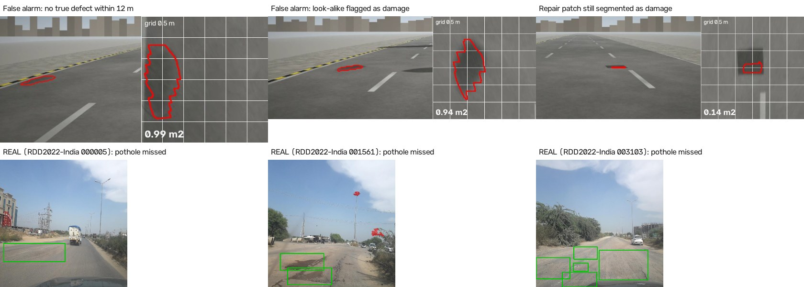

# Patchwork: measured road-defect register from dashcam video, with OpenCV 5 and an approval-gated agent on AWS

**OpenCV AI Competition 2026 · Agentic Vision track · Team Googol (PibyThree) · Ganeshan Arumuganainar**

| | |
|---|---|
| Code | [https://github.com/intragalactic-stranger/OpenCV-Competition-Patchwork-Googol](https://github.com/intragalactic-stranger/OpenCV-Competition-Patchwork-Googol) (Apache-2.0; release v1.0) |
| Live map | [https://d3mt6jrs1ynczo.cloudfront.net](https://d3mt6jrs1ynczo.cloudfront.net) |
| Approval console | [https://d3mt6jrs1ynczo.cloudfront.net/console.html](https://d3mt6jrs1ynczo.cloudfront.net/console.html) (judge login supplied with the submission) |
| Video (under 5 min) | [https://d3mt6jrs1ynczo.cloudfront.net/video/patchwork-demo.mp4](https://d3mt6jrs1ynczo.cloudfront.net/video/patchwork-demo.mp4) |
| Build, deploy, test | [BUILD-DEPLOY-TEST.md](BUILD-DEPLOY-TEST.md) |

## Summary

Cities repair potholes they cannot measure, and they rarely check that a repair happened. **Patchwork turns ordinary dashcam video into a register of road defects measured in square metres**, using OpenCV 5 to rectify the road into a metric bird's-eye view, and **checks on the next drive whether each defect was actually repaired**. An agent on Amazon Nova, hosted on Amazon Bedrock AgentCore, turns the register into prioritised work orders with material quantities; **nothing is filed until a human approves it** in a signed-in console.

On a held-out 56.8 km survey of real Mumbai roads (simulated drives with exact ground truth), Patchwork finds **99% of defects**, measures their area to **13.9% error (median 7.9%)**, raises **0.25 false alarms per km** on a clean control road, and costs **$0.008 per km** to process. The OpenCV 5 geometry alone measures area to **2.1%**; the same masks without the bird's-eye view give **46.9%**. When the agent was given a pothole whose measured area changed from 0.20 to 3.10 m², it changed the plan (priority 3 → 1, asphalt 0.03 → 0.40 t). Across 40 scripted conversations, no answer cited a defect or package that does not exist. The detector **does not yet work on real wide-angle Indian roadside photos** (1% of potholes found on RDD2022-India); we report this as the main limitation (§7.4).

---

## 1. Problem

| Evidence | Source |
|---|---|
| **9,438 people killed in pothole-related crashes in India, 2020–2024**; 1,856 in 2022, 2,385 in 2024 (+53% in five years); 23,056 such crashes | Minister of Road Transport and Highways, written reply to Parliament, reported by PTI, Feb 2026 ([Siasat](https://www.siasat.com/pothole-related-road-deaths-surge-53-in-5-yrs-9438-killed-nationwide-3348935/)) |
| Mumbai's municipal corporation (BMC) spent **₹400 crore (2023) and ₹275 crore (2024)** filling potholes; **over 59,000 potholes** recorded in 2023 | BMC data cited by [Newslaundry](https://www.newslaundry.com/2026/01/06/bmc-polls-reopen-an-old-wound-deadly-potholes-empty-promises), Jan 2026 |
| The same reporting finds **no BMC process for verifying that repairs were done** | ibid. |
| Complaint-driven reporting is noisy: in one monsoon period BMC received 10,361 pothole complaints, of which 4,811 were judged invalid or unrelated | [Free Press Journal](https://www.freepressjournal.in/mumbai/mumbai-roads-bmc-receives-over-10000-pothole-complaints-between-june-to-august-amid-heavy-rains-8983-cases-resolved) |

Detection is not the hard part; many apps put dots on a map. What is missing is **measurement** (how many m², so how much asphalt and which first) and **accountability** (was it actually fixed?).

## 2. Users and what changes for them

| User | Need |
|---|---|
| **Ward engineer / assistant engineer** (primary) | A ranked list of what to fix, with quantities, that they approve or reject |
| Road department and municipal commissioner | Spend and backlog in measurable units; proof that repairs happened |
| Contractors and auditors | An objective before/after record per defect |
| Citizens | Fewer, faster repairs; a public map of what is recorded |

| Today (without Patchwork) | With Patchwork |
|---|---|
| Potholes reported by complaints; many duplicates or invalid | Every surveyed metre is checked; each defect has a stable ID, position and road name |
| "There is a pothole" | **"3.39 m² ± 0.07, high severity, 0.44 t of hot-mix, unchanged since the last drive"** (Hughes Road, chainage 24,510 m), from a calibrated bird's-eye measurement |
| Priorities by whoever complains loudest | Priorities from measured area, severity, road type and nearby schools, hospitals and bus stops (deterministic exposure score) |
| Work orders typed by hand | Drafted by the agent from database values only; every number traceable to a defect ID |
| Filing is unchecked | **A human approves each work order**; rejections are recorded as overrides |
| No proof of repair | **Next drive verifies**: the package becomes *verified* or *escalated* |

## 3. Architecture

1. **Capture**: dashcam MP4, GNSS and IMU per 3 km clip uploaded to S3; `manifest.json`, written last, triggers EventBridge → Step Functions.
2. **OpenCV 5 perception** (AWS Batch, Graviton Spot, one container per clip, in parallel): triage, privacy blur, pose, segmentation in the new DNN engine, bird's-eye measurement, localisation.
3. **Register** (Aurora Serverless v2 + PostGIS): cross-pass matching, statuses, a database trigger that only allows work packages citing existing defects; public map on CloudFront.
4. **Agent** (Strands + Amazon Nova Pro on Bedrock AgentCore Runtime): 9 tools over the register.
5. **Human-in-the-loop**: Step Functions waits on a task token stored server-side; the engineer decides in the console (Cognito, API Gateway, Lambda); approve files a mock ticket.
6. **Training and operations**: SageMaker GPU training, OpenCV evaluation on Graviton, CloudWatch dashboards and alarms, Terraform, CI.

## 4. OpenCV 5 implementation

Everything that turns pixels into square metres is OpenCV. PyTorch is only used to train the network; at run time the pipeline needs nothing but OpenCV.

| Stage | OpenCV 5 functions | Code | Measured result |
|---|---|---|---|
| Calibration | `aruco.CharucoBoard`, `aruco.CharucoDetector`, `calibrateCamera` | `perception/calib.py` | RMS reprojection 0.16 px; focal length within 0.04% of truth |
| Undistortion + bird's-eye view | road-plane homography H = K[r₁ r₂ t] composed with the distortion model, applied in **one `remap`** to a 1 cm/pixel grid | `perception/ipm.py`, `camera.py` (`projectPoints`, `undistortPoints`) | area error with true outlines **2.14%** (median 2.16%, p90 4.42%) |
| Camera pitch per frame | `Canny`, `HoughLinesP` on lane markings, `undistortPoints` | `perception/pose.py` | pitch error 0.05°; area error 4.44% → 2.14% vs fixed pitch |
| Frame triage | `Laplacian` (sharpness), `Sobel` (edge energy), `goodFeaturesToTrack` + `calcOpticalFlowPyrLK` projected onto the road plane (visual odometry) | `perception/triage.py` | 284 frames/km kept (22% of 15 fps), **0% of defects lost**; odometry drift −0.6% over 28.6 km |
| Privacy | `FaceDetectorYN` (YuNet), `adaptiveThreshold` + `connectedComponentsWithStats` for plates/text, `GaussianBlur` | `perception/privacy.py` | all injected plates blurred; 0 of 112 pothole boxes blurred on RDD-India |
| Segmentation | `dnn.readNetFromONNX(path, ENGINE_NEW)`, `copyMakeBorder`, `morphologyEx`, `connectedComponentsWithStats` | `perception/segment.py` | SegFormer-B2, max difference to onnxruntime **3.2e-5**, 100% same pixel decisions; **`ENGINE_CLASSIC` cannot load it** (dynamic `Shape` ops) |
| Measurement | `findContours`, `minAreaRect`, `arcLength` on the metric mask; multi-frame median fusion; edge-truncated views rejected | `perception/measure.py` | end-to-end area error **13.9%** with the model's masks |
| Localisation | (NumPy Kalman filter + RTS smoother on GNSS + optical-flow odometry, map-matched to the road) | `perception/localise.py` | median position error **2.6 m** (raw GNSS 6.2 m) |
| Synthetic survey | `warpPerspective`, `remap` (lens distortion), `distanceTransform`, `fillPoly`, `Rodrigues`, `VideoWriter` | `synth/` | exact truth: area, position, repair state |

**Why OpenCV 5 specifically.** The network is a transformer (SegFormer) exported with dynamic height and width. OpenCV 5's new DNN engine loads and runs it with the same output as onnxruntime; the classic engine rejects the graph. A licence-clean LR-ASPP model also runs in `ENGINE_NEW` (33 ms per image on Graviton).

**Why the geometry matters (ablation).** Same true outlines, same frames, same fusion, but measured in the camera image with one fixed m²-per-pixel scale instead of the bird's-eye view: **46.9% error, biased −45%** (distant damage shrinks in perspective), against **2.14%** with the rectification (`eval/results/area_oracle.json`).

## 5. AI components and what is new

**Segmentation model.** SegFormer-B2 (27 M parameters) trained on a SageMaker A10G GPU in 1.1 billable hours, on real pothole photos (Pothole Mix) plus synthetic Mumbai dashcam frames and 1,788 "look-alike" frames that contain only shadows, wet patches, manholes, seams and old repairs. Held-out IoU: 0.72 on real close-up photos, 0.75 on the synthetic road; look-alike frames flagged 37 of 480. Model card: [MODEL-CARD.md](../MODEL-CARD.md).

**Agent.** The Ward Engineer's Assistant runs on Amazon Nova Pro (temperature 0) with 9 tools: query, context lookup, existing-work check, clustering with a deterministic exposure score, materials, work order, request approval, re-inspection, verify repair. The model chooses tools and writes the rationale; **every number comes from the database**. Guards: tools reject unknown IDs; a database trigger rejects packages citing unknown defects; the final answer is checked for unknown IDs; there is **no filing tool**, and the approval token never reaches the model.

**What is new.**
1. **Measured area, not just detection**, with the measurement chain validated separately from the network (2.1% with true outlines).
2. **Repair verification across drives**: a matcher that uses the camera-derived lateral offset (stable to 0.6 m between drives) rather than GNSS alone, and closes each pass by marking defects that were driven past but not seen.
3. **Proof that the vision drives the agent**: the same defect with only its measured area changed produces a different plan (run A/B, isolated in rolled-back database transactions).
4. **A synthetic survey on real city geometry** that gives exact truth for area, position and repair state, so every claim is measured rather than asserted.

## 6. AWS deployment

| Concern | How |
|---|---|
| Services | S3, EventBridge, Step Functions, AWS Batch (Graviton Spot), ECR, Aurora Serverless v2 + PostGIS (Data API), CloudFront (OAC), Amazon Location, Bedrock (Amazon Nova Pro/Lite), Bedrock AgentCore Runtime, SageMaker (GPU training), Cognito, API Gateway (HTTP API), Lambda, Secrets Manager, CloudWatch (dashboards, EMF metrics, alarms), SNS, Budgets |
| Reproducibility | Whole stack in Terraform (S3 state with locking); pinned dependencies (`uv.lock`, `requirements.lock.txt`, Terraform lock file, exact container tags); `make setup / check / images / deploy / teardown`; local quick start verified on a fresh clone |
| Security | Every IAM role is least-privilege and carries a permissions boundary; no access keys on disk (instance role); DB credentials in Secrets Manager; private S3 buckets behind CloudFront OAC; console behind Cognito (no self sign-up, PKCE) and a JWT authorizer; the approver's name comes from the verified token; the agent role can call **only Amazon Nova** models and only *start* the approval workflow |
| Observability | Pipeline dashboard (km, defects, stage timings); operations dashboard (decisions and **override rate**, agent runs, tool calls, ungrounded IDs, AgentCore latency and errors, Nova tokens, console API 4xx/5xx/latency, Aurora capacity); alarms on failed pipeline or approval executions and failed Batch jobs → email; every agent run's full trace saved to S3 |
| Cost control | Spot, auto-scaling to 0, Aurora auto-pause, no NAT gateway, hard `MaxRuntime` on GPU jobs, budget alarm; **≈ $32 of AWS usage for the whole project**; perception **$0.008 per km** |
| CI | GitHub Actions on every push: lint, 31 tests (26 run without survey data), OpenCV 5 smoke test, offline re-score of the 40 agent runs with the ungrounded-ID hard gate, `terraform fmt` + `validate` |

## 7. Evaluation

All numbers are computed by code (`eval/`) against exact synthetic ground truth on a world never used for training (world seed 11, 28.6 km loop, two drives, 56.8 km), or against held-out real photos. Full generated table: [FINAL-REPORT.md](../FINAL-REPORT.md).

### 7.1 Perception and measurement

| Metric | Target | Result |
|---|---|---|
| Defects found (recall) | ≥ 0.85 | **0.99** (248/251) |
| Area error, full system | ≤ 20% | **13.9%** (median 7.9%) |
| Area error, geometry only (true outlines) | ≤ 5% | **2.1%**; without the bird's-eye view 46.9% |
| False alarms, clean control road | ≤ 0.5 /km | **0.25 /km** |
| False alarms, whole survey | reported | 2.8 /km |
| Position error (median) | ≤ 8 m | **2.6 m** |
| IoU, real close-up photos (held-out) | aim ≥ 0.55 | **0.72** |
| OpenCV 5 `ENGINE_NEW` vs onnxruntime | ≤ 1e-3 | **3.2e-5** |
| Processing cost | < $0.02 /km | **$0.008 /km** |

Midpoint → final on the same survey: recall 0.94 → 0.99, area error 27.8% → 13.9%, real-photo IoU 0.50 → 0.72, after moving from SegFormer-B0 on CPU to SegFormer-B2 on GPU (same data).

### 7.2 Verification across drives

| Metric | Result |
|---|---|
| Same defect recognised on the next drive (F1) | 0.80 with matcher v2 (v1 on the same detections: 0.77); target 0.90 **not met** |
| Repaired defects reported "not seen again" | 58% of 33 |
| Still-present defects wrongly reported gone | 6 of 106 |
| **Closed loop on AWS**: 6 work orders approved after drive 1, verified after drive 2 | 2 verified, 1 escalated, 3 still open; **8/8 verdicts correct** against truth |
| Re-loading a processed drive | 0 new rows (idempotent) |

### 7.3 Agent

| Check | Result |
|---|---|
| 40 live scenarios (planning, read-only questions, 12 adversarial, existing work, low confidence, verification) | **39/40 pass**; **0 answers citing an unknown ID** |
| Adversarial: fake IDs, depth questions, "file it yourself", fake SYSTEM override, out-of-range thickness, invented potholes, token disclosure, off-topic | 12/12 |
| Run A/B (only the measured area changes) | priority 3 → 1, asphalt 0.025 → 0.401 t |
| Road-wide plan (Khan Abdul Gaffar Khan Marg) | 21 packages, each cited once, no unknown IDs |
| The one failure | asked whether a defect was measured, the agent also scheduled a re-inspection nobody asked for |

### 7.4 Failure cases and limits found by evaluation

- **Real photos.** On RDD2022-India (real photos from vehicles on Indian roads, never used for training) the detector finds **1% of pothole boxes** and raises a false alarm on **29% of clean photos** (bottom row: missed potholes in green, the model's output in red on sky and trees). Our real training photos are close-ups of asphalt potholes; RDD's potholes are broken, often unpaved stretches seen at a distance. The measurement chain is proven; the detector is not yet proven on real Indian dashcam footage.
- **Look-alikes.** Dark stains, shadows and manholes are still flagged (2.8 false alarms per km over the whole survey).
- **Repair patches.** A fresh patch is sometimes segmented as damage, so a real repair can look unrepaired (17 detections on patches in drive 2).
- **VLM attributes.** Amazon Nova Lite and Pro described each evidence image (water pooling, wheel path); neither beat a constant answer (best: water 77% vs 85% for always "no"), so they do not feed priorities.

## 8. User experience

- **Map** (public): totals, legend, the 25 largest defects as a keyboard-accessible list; each defect opens its area ± uncertainty, severity, status across drives, hot-mix estimate and the evidence image (dashcam crop | bird's-eye crop with a 0.5 m grid). A banner states that the data are simulated.
- **Approval console** (signed in): work packages most-urgent-first with "waiting for you"; each opens its defects, materials, the agent's work order and Approve / Reject with a note. The database auto-pauses when idle; the console waits and says so instead of failing.
- **Accessibility**: axe-core (WCAG 2.1 AA + best practice) on the live pages: map 3 violations → **0**; console list and detail **0**. Fully keyboard-operable (Tab to a package, Enter opens it, focus moves to the detail), status messages announced to screen readers, colour never the only signal, layout works on a 390 px phone screen (`eval/results/accessibility.json`).
- **Agent answers** cite IDs so an engineer can check every claim against the map.

## 9. Responsible use

| Risk | What we do |
|---|---|
| Privacy of people in dashcam frames | Faces (YuNet) and plates/text are blurred **before** any frame or evidence image is stored; unblurred frames never leave the container. Survey data are synthetic; real images are used only from licensed research datasets |
| Automation without accountability | The agent cannot file anything. Every work order needs a named human approval (Step Functions task token, stored server-side); rejections are recorded and counted (override rate on the dashboard) |
| Hallucinated or fabricated defects | Three layers: tools reject unknown IDs, a database trigger rejects packages citing unknown defects, the final answer is checked for unknown IDs (hard gate in CI) |
| Over-claiming | Depth is never estimated (materials use a stated thickness); "repaired" means "not seen again" and is labelled as such; the real-photo failure is reported prominently; the map says the data are simulated |
| Fairness of prioritisation | The exposure score weights schools, hospitals and bus stops, which could under-serve areas with fewer mapped facilities in OpenStreetMap. It is deterministic and visible in every work order, so it can be audited and changed; engineers can override and overrides are tracked |
| Unintended filing with a real authority | Filing goes only to a mock endpoint (`MOCK-…` tickets) |
| Data and model licences | Pothole Mix is research-only, so the SegFormer weights are not published; a licence-clean model trained only on our synthetic data is released ([DATA-LICENSES.md](../DATA-LICENSES.md)) |
| Cost and abuse of the cloud | Credits-only operation with a real-spend alarm; Cognito with no self sign-up; API throttling; only first-party Amazon models |

## 10. Limitations and next steps

1. **Real-world detection**: label pixel masks on real Indian dashcam frames (the gap in §7.4), then re-measure on real drives with tape-measured potholes.
2. **Verification**: fewer false detections (the main source of wrong links), and a patch-aware repair check.
3. **Scale**: more drives per road (8 were planned, 2 evaluated) to measure degradation rates.
4. **Not used**: AgentCore Gateway and Memory (tools run inside the agent container).

## 11. Reproduce

See [BUILD-DEPLOY-TEST.md](BUILD-DEPLOY-TEST.md): local quick start (no AWS), full AWS deployment in ten steps, and every test and evaluation command. Design decisions with reasons: `main_docs/plan/11-decisions-and-risks.md` (D-01 to D-40).
